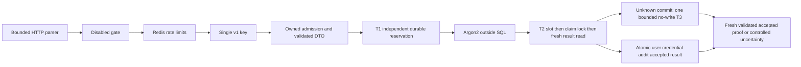

# Phase B development implementation and review boundary

This stacked development candidate implements A1 and S1–S6. It is not merged-main,
independent security approval, production readiness or signup activation. Source
default remains `SIGNUP_ENABLED=false`. AUTH-001 remains incomplete: registration
policy, email ownership verification/delivery and unverified-account restrictions
are separate work. Exact revisions, CI results and pending reviews belong to the
stacked PRs and the sanitized CI validation artifact, not to a claimed deployment.

The owner's autonomous development mission authorizes the corrections and Option A
development schema. Historical proposal-only authorization headers in
[design PR #11](https://github.com/ryukkfk/authcore/pull/11) at
`49fc8e9f63bd40bedcf83bd3b10823732ae4dba7` remain historical records. They are
not implementation evidence. This record describes inspected code on this stack.

## Architecture and trust

Retained acceptance can return during T1/T2 before hashing or domain execution.
The response axis and actual ownership settlement are independent. Admission owns
native hashing, in-flight work, late checkouts and quarantined disposal until they
actually settle. Shutdown drains admission before database/Redis teardown and
does not manufacture successful drain from a timeout.

PostgreSQL is canonical. One checked primary with `fsync=on`, synchronous commit
and READ COMMITTED is necessary but does not establish failover lineage. All
writers must participate in the same slot/claim/fresh-read protocol. The restricted
role is a trusted writer, not an untrusted SQL sandbox: its permitted INSERTs can
forge audit/accepted rows if compromised. Owner/superuser can violate retention.

The four fixed transaction advisory slots bound participating SQL critical sections.
Local four-work admission retains actual work. Redis admission leases expire and
cannot fence PostgreSQL or enforce a hard fleet-wide Argon2 memory ceiling. Hot-key
contention may consume slots; fairness and production throughput are not proved.

## Implemented decisions

| Decision | Development implementation                                                                                                                               | Remaining operational boundary                                                                                               |
| -------- | -------------------------------------------------------------------------------------------------------------------------------------------------------- | ---------------------------------------------------------------------------------------------------------------------------- |
| D01      | Mandatory one ASCII v1 key; exact generic202; fixed400/409/500/503; no-store; replay uses existing rate/admission                                        | Client policy and ingress approval                                                                                           |
| D02      | 16KiB actual uncompressed UTF-8 JSON bytes; invalid UTF-8 fails400 before binding; header8KiB/64fields; upload5s; Node header5s/request10s targets       | Proxy preservation of duplicate fields, TLS and representative ingress budgets; native408/431/close can precede app          |
| D03      | Explicit dedicated32-byte secret plus approved immutable version/KAT metadata; startup attestation and durable namespace anchor; no fallback or rotation | Secret manager/composition, fleet attestation and operator-provisioned anchor                                                |
| D04      | Option A append-only committed terminal expiry; original claim binding and expiry unchanged; retained result first                                       | Retention/privacy/client policy; no unobserved absolute elapsed-time deadline guarantee                                      |
| D05      | Fixed4 two-int32 advisory slots; slot-before-claim order; nonblocking one-pass acquisition                                                               | Fleet namespace inventory, fairness and capacity assessment                                                                  |
| D06      | Independent phase/outcome/cleanup/proof; exact COMMIT tags; one no-write recovery; accepted-proof latch                                                  | Primary lineage; budgets are measured targets, not hard request deadlines                                                    |
| D07      | No ledger cleanup or deletion path                                                                                                                       | Storage high-water/retention/tombstone policy; unbounded-duration use prohibited pending capacity approval                   |
| D08      | Actual native work retained within each process; real multi-process SQL tests                                                                            | Global memory controls need bounded process topology/OS limits or a separately reviewed scheduler; leases/slots insufficient |
| D09      | Detected drift fails closed; no secret rotation/rebinding                                                                                                | Incident authority and cross-version reconciliation design                                                                   |
| D10      | Catch only DuplicateUserEmailError; existing account credential/audit untouched; append accepted result atomically                                       | Enumeration timing study under representative faults and load                                                                |
| D11      | No replica recovery or missing-result-to-rollback inference                                                                                              | Durability/failover/split-brain evidence and containment owner                                                               |
| D12      | Default off; historical writer is test support excluded from production artifacts                                                                        | All-writer rollout inventory and separately approved activation                                                              |
| D13      | Fixed error events and bounded diagnostic counts; no password/key/digest/URL/SQL error logging                                                           | Instrumentation/crash-dump policy and independent timing/security review                                                     |

S1 targets: acquisition1s; setup1s; normal transaction15s after BEGIN;
statement5s/lock1s/idle3s; recovery3s aggregate starting before BEGIN with
statement1s/lock500ms/idle1s; aggregate cleanup1s. Stronger inherited PostgreSQL
transaction timeout is preserved and session cap installed before BEGIN. Scheduling,
native hashing and unresolved transport owners prevent a hard whole-request claim.

## Driver, schema and supply chain

[A1 driver disposal](../packages/db/A1_DRIVER_DISPOSAL.md) defines the public
checkout-scoped release/dispose contract, including observer exceptions, idempotent
removal, waiters, late closure and shutdown. Exact `pg@8.23.1` and `pg-pool@3.14.0`
MIT patches are pinned by pnpm; original tarball integrity, source/license/patch
SHA-256 values are checked after a clean frozen install. Application production
code does not inspect private pool bookkeeping. A local transport receipt never
proves immediate remote rollback or backend absence.

S2 adds migration0004, a singleton namespace and append-only terminal-event table,
and a claim-version index. Existing migrations/snapshots remain intact. Seven-table
restricted-role inventory has40columns: namespace SELECT only; terminal SELECT/INSERT;
claims UPDATE only on inert lock_anchor; no history UPDATE/DELETE/TRUNCATE or escalation.
S3–S6 add no runtime dependencies, migration or grants. Repository permission scripts
are operator-invoked; API startup does not provision, migrate or rotate anything.

CI pins official checkout/setup-node/pnpm/action-setup/upload-artifact v4 commits.
Upgrades require re-verifying upstream identity, review and full clean-install
regressions. Advisory scan is a dated signal, not absence-of-vulnerabilities proof.
CI container tags are resolved afresh; actual image digests and server versions are
recorded in the run logs. Containers are test infrastructure, not release artifacts.

Disposable GitHub-hosted PostgreSQL alone uses terse server errors with SQL/row-detail
logging disabled to avoid publishing credential fixtures in failure container logs.
Client SQLSTATE/constraint fields remain verified, and transactional audit is unchanged.
This script refuses a live URL/non-hosted context; it is not a production logging policy.

## Security review findings and limits

This is the implementer's code-level review, not independent approval. Corrected:
release observer ownership leak (A1); ROLLBACK-tag false success and post-ACK masking
(S1); secret/version drift and reversible timestamp-only expiry refusal (S2); SQL
capacity and stale-work boundaries (S3); accepted-proof/atomic recovery precedence
(S4); mandatory key, disconnect-before-interceptor race and missing-grant account
enumeration oracle (S5); idle-pool error serialization/crash and permissive UTF-8
credential decoding (S6). Regressions retain the original failed evidence.

Sensitive material remains in transient JS/native memory and can be exposed by
external instrumentation or compromised runtime/DB credentials. Privilege checks
do not lock ACLs against concurrent privileged DDL. Quarantined owners can exhaust
local capacity; operators must alert and contain, not clear ownership or accepted
proof. Historical S0 evidence and original blocked S1 work remain unchanged.

Required independent reviewers: PostgreSQL driver lifecycle/provenance; transaction
evidence and distributed recovery; cryptographic configuration/retention and grants;
HTTP enumeration/cancellation and operational capacity. Passing CI is not their approval.

## Validation and release gates

[Failure matrix](Phase%20B%20Failure%20Matrix.md) maps F01–F28 and T01–T17 to real,
synthetic and operational evidence. CI runs lint/build/typecheck, driver integrity,
production advisory/artifact checks, unit, real PostgreSQL/Redis and real HTTP tests.
Its sanitized summary deduplicates assertions and fails if a guarded/skipped case
has no passed dedicated execution. Repeated suites are not new coverage. No local
synthetic test substitutes for disposable server evidence. Test-owned databases,
roles, sessions, child processes, proxy sockets and Redis keys must actually settle.

Production remains gated on independent human review and repository protections;
primary/failover durability; live restricted-role adoption; secure HMAC/anchor/fleet
composition; retention/privacy/client policy and storage limits; all-writer rollout;
ingress/TLS limits and duplicate preservation/rejection; representative enumeration
timing; fleet Argon2 memory controls; AUTH-001 registration prerequisites; separately
authorized deployment and public activation. None is self-certified here.

## Safe rollback

Disable entry first. Drain/contain every writer and inspect actual local owners plus
authoritative PostgreSQL backends; a closed local socket is not remote settlement.
Preserve all namespace, claims, results, terminal events, credentials and audit data.
Do not restore the old unkeyed service or drop migration0004. If driver rollback is
required, keep signup off and deploy a reviewed artifact known not to need the new
disposal contract; removing only the patch beneath S1 is unsafe. Database/secret
restoration or namespace retirement requires separate reviewed reconciliation.
