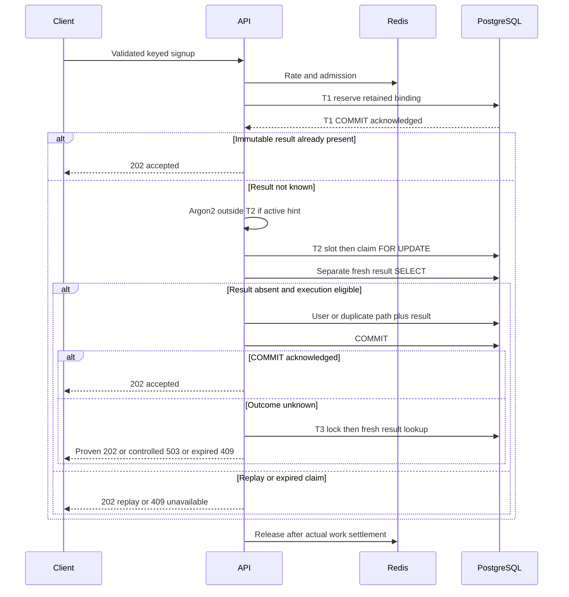

# Signup Phase B Architecture

> Design proposal for human review, 2026-10-12. Baseline:
> `a0bd2d7ff6499e393a3dabb46617f6292f23c84e` (merged documentation PR #10).
> No Phase B behavior is implemented or approved by this document.
> `SIGNUP_ENABLED=false`; AUTH-001 remains incomplete; production readiness is not established.

## Evidence and scope

The integrated baseline contains Phase A primitives, not HTTP idempotency. Historical
[CI #22](https://github.com/ryukkfk/authcore/actions/runs/38207585792) and
[post-merge CI #23](https://github.com/ryukkfk/authcore/actions/runs/38207873631)
passed 350 distinct tests: workspace 214, PostgreSQL 99, Redis 28, HTTP E2E 9.
CI #22 targets PR #10 head `c99699b8003ed069caac0ddb6f1eea5fb3ec6fc7`;
CI #23 targets the baseline merge above. Both job logs were inspected for those totals.
Those results do not verify Phase B
or constitute independent human security approval. Earlier evidence remains in the
[Integration Checkpoint](../Integration%20Checkpoint.md).

| Verified implementation | Evidence | Consequence |
| --- | --- | --- |
| `/api/v1/auth/signup` returns 202 and exactly `{"status":"accepted"}`; controller swallows only `EmailAlreadyInUseError` | [controller](../../apps/api/src/identity/auth.controller.ts) | Preserve generic success; move duplicate handling inside the future ledger transaction |
| DTO trims email, validates email and password length, rejects unknown fields through global pipes | [DTO](../../apps/api/src/identity/dto/signup.dto.ts), [bootstrap](../../apps/api/src/main.ts) | Validate before HMAC; preserve exact password string |
| Argon2 precedes transaction; user, credential and mandatory audit share one transaction | [service](../../apps/api/src/identity/signup.service.ts) | Keep hashing outside the account transaction; add result atomically |
| Targeted email conflict uses `ON CONFLICT DO NOTHING`, then throws a JavaScript domain error | [user repository](../../packages/db/src/repositories/user.repository.ts) | Catching this precise error inside the transaction leaves SQL usable |
| Transaction owner owns one checked-out client and teardown, but exposes no COMMIT classification and may throw on release after acknowledged COMMIT | [transaction owner](../../packages/db/src/signup-transaction.ts) | A success latch and explicit outcome state are prerequisites |
| Claims have unique versioned HMAC identity, immutable payload binding and expiry; results have claim PK, RESTRICT FK and exact accepted response CHECK | [schema](../../packages/db/src/schema/signup-idempotency.ts), [migration 0003](../../packages/db/drizzle/0003_signup_idempotency.sql) | Claim retention is essential; no mutable status/epoch exists |
| Reservation and locking are caller-owned primitives, not service orchestration | [ledger repository](../../packages/db/src/repositories/signup-idempotency.repository.ts) | Reservation must commit separately; `lockByKey` requires a transaction |
| Redis admission has four local/distributed slots, 30-second leases, 10-second renewals; `assertSignupLease` is a no-op without its async-local context | [admission](../../apps/api/src/identity/signup-admission.ts) | A lease can expire before a PostgreSQL transaction ends; future internal writers must not bypass the admission contract |
| Lock/statement/transaction/idle timeouts are 1/5/15/3 seconds; teardown is 1 second | [transaction owner](../../packages/db/src/signup-transaction.ts) | Timeouts reduce exposure, but do not prove COMMIT outcome |
| Restricted runtime has SELECT/INSERT on five tables and only column UPDATE on `lock_anchor=false` | [permission SQL](../../packages/db/permissions/signup-runtime-role.sql) | Keep all grants, CHECKs and protected history unchanged |

Additional inspected boundaries: [credential repository](../../packages/db/src/repositories/password-credential.repository.ts),
[audit repository](../../packages/db/src/repositories/security-audit-event.repository.ts),
[Redis transport](../../apps/api/src/redis/redis.service.ts),
[rate limiter](../../apps/api/src/identity/signup-rate-limiter.ts),
[exception filter](../../apps/api/src/common/filters/global-exception.filter.ts),
[database pool](../../packages/db/src/client.ts), and [password hashing](../../packages/crypto/src/password.ts).
The pool is max 10 per process, with a 5-second connection timeout. Argon2id uses
64 MiB memory, time cost 3, parallelism 1. These settings are not throughput measurements.

## S0 evidence integration and typed outcomes

S0 [PR #12](https://github.com/ryukkfk/authcore/pull/12) head
`822062fea79fad3e5a8547dc9f7b40b999f7cb71` and
[CI #28](https://github.com/ryukkfk/authcore/actions/runs/38232288230) establish
nine real PostgreSQL cases with zero skips, 369 existing regressions and 378 total
distinct passes. PostgreSQL 17.11 had fsync=on, synchronous_commit=on and primary mode;
test-owned cleanup inventories matched. This is disposable-CI characterization,
not Phase B service/HTTP correctness, failover proof or production approval.
The [evidence ledger](Signup%20Phase%20B%20Test%20Plan.md#s0-verified-evidence)
separates real, synthetic, confirmed-defect, proposed-control and operational-assumption evidence.

Adopt the pending [D06 decision](Signup%20Phase%20B%20D06%20Decision.md), with separate
transaction evidence, business proof and cleanup health:

| Evidence | Proposed interpretation |
| --- | --- |
| COMMIT not submitted | NOT_SUBMITTED; no local COMMIT dispatch, not server rollback/lock-release proof |
| Correlated server-confirmed abort | ABORT_CONFIRMED; map the frozen primary failure, never callback success |
| COMMIT may have been submitted without exact completion | COMMIT_UNKNOWN; no retry of domain work; bounded independent recovery |
| Exact COMMIT command tag | COMMIT_ACK for that transaction; accepted only if it is the atomic accepted-result T2 |
| COMMIT resolves with ROLLBACK tag | COMMIT_ROLLBACK; definite abort; current owner false success is real S0-03 defect |
| Post-ACK release/cleanup failure | Cleanup-health failure, not reversal of commit; S0-04 exposes current masking and retained checkout |
| Fresh matching authoritative immutable result | ACCEPTED business proof, without necessarily classifying the earlier attempt's history |

Promise resolution alone is never committed success. Once validated accepted proof is
latched outside callback/catch/finally, cleanup, cancellation and Redis errors cannot
downgrade it. Retain independent cleanup diagnostics and dispose/evict the resource.
T1 reservation COMMIT, missing result, socket destruction and Redis lease expiry
never establish signup acceptance or historical rollback. Exact precedence, bounded
late-checkout/operation ownership and residual limits are in D06.

## Recommended protocol (proposed)

Use one authoritative PostgreSQL primary lineage, retained immutable claims, a
separately committed reservation T1, and a serialized account/result transaction T2.
Use Redis for rate limiting and admission; PostgreSQL determines whether domain work
can execute. No claim deletion, automatic expiry renewal or HMAC rotation is included.

The participating tables remain exactly `users`, `password_credentials`,
`security_audit_events`, `signup_idempotency_claims`, `signup_idempotency_results`.
D06/S1 preserves the current schema and grants. D04 option A would require a separately
approved terminal-state schema/permission expansion before expiry integration; no
such change is authorized here. Owners/superusers can alter
history, and allowed runtime INSERT can fabricate new rows after credential compromise.
This protocol assumes trusted application writers and does not make storage tamper-evident.
Live use of restricted credentials has not been established.

1. Apply transport limits, disabled guard, rate limiting, header validation, admission
   and DTO validation in the order defined by the [HTTP Contract](Signup%20Phase%20B%20HTTP%20Contract.md).
   Compute frozen v1 HMAC binding using one explicitly injected, fleet-consistent secret/version.
2. T1: acquire a connection, explicitly select READ COMMITTED, install bounded timeouts,
   acquire one proposed PostgreSQL capacity slot, then call the existing `reserve` with
   an explicit finite future expiry computed from database current time plus the approved
   execution window. The existing application-clock validation and database CHECK remain;
   disagreement fails closed. Inspect an existing immutable result as a positive
   replay hint. Commit T1 **before hashing or any account writes**. Reservation is not success.
3. A committed accepted result permits replay without Argon2 or account lookup. If T1
   acknowledgement is lost, do not begin account work until a fresh bounded lookup
   establishes the retained matching claim; otherwise return 503. A miss proves nothing.
4. If no result is known and the claim appears active, hash the validated password
   outside T2, holding local/Redis admission. An expired hint skips hashing but still
   requires the authoritative T2 lock/result check. Hints never authorize writes.
5. T2: acquire one PostgreSQL slot, lock the same claim using `lockByKey`, verify its ID
   and immutable binding, then read results in a **separate statement after the lock**.
   A missing/replaced claim is an integrity/unavailability condition (503), not permission
   to reserve a substitute inside T2. A valid result latches accepted proof before any cleanup, then returns the constrained 202 response.
6. If no result, apply the selected [D04 policy](Signup%20Phase%20B%20D04%20Decision.md)
   under the same lock. No policy is approved. Recommended A requires durable terminal
   proof before permanent 409 and a separately reviewed terminalization writer; T3
   never writes it. Alternative B compares `expires_at` with fresh database
   `clock_timestamp()` and may reverse a previous timestamp-based refusal after
   backward clock movement. Without an approved policy, do not authorize execution.
   Active eligibility still requires admission/cancellation immediately before domain
   mutations. Execution-start cutoff permits previously authorized work to commit late;
   it is not a wall-clock COMMIT deadline or permanent timestamp-only expiry guarantee.
7. Try user INSERT. A new user requires exactly one credential and mandatory
   `identity.user_created` audit INSERT. Catch **only** `DuplicateUserEmailError`
   inside T2: do not modify credentials or add a user-created audit for an existing
   account, including a legacy account without that audit. In either accepted path,
   append the fixed immutable result using `recordAccepted` before COMMIT.
8. COMMIT T2 using the proposed outcome-aware owner. Only exact COMMIT_ACK for the atomic accepted-result T2 or a
   validated authoritative immutable-result proof permits 202. Unknown outcome uses bounded recovery;
   no hidden recursive account retry. Response delivery is separate from database success.

Two different keys for the same normalized email may legitimately create two accepted
ledger results but only one user, one credential and one creation audit. A replay must
never rehash, replace credentials, recreate audit events, or query account existence once
its result is known. A racing hint miss can still cause unnecessary hashing before T2;
the lock/result check prevents repeated domain writes, not all repeated CPU work.
The target guarantee is at most one committed accepted outcome per retained binding;
aborted SQL attempts may repeat and HTTP delivery is not exactly-once.

## Synchronization and capacity boundary

Recommended lock order is **one transaction-level capacity slot -> one claim row ->
user unique index -> credential -> audit -> result**. No transaction handles two claims.
The proposed fixed four advisory slots use `pg_try_advisory_xact_lock(namespace, slot)`
with internal constants, never a client-controlled namespace. All T1/T2/T3 lock-capable
transactions participate; try slots nonblocking and release unsuccessful transactions.
At most one successful slot is held. Transaction end releases the slot on the server.
This needs restricted-role verification and approval; it is not implemented.

These slots bound participating PostgreSQL critical sections, **not fleet-wide Argon2
memory, total connections, or all SQL**. Redis expiry can admit another process while
an old process is hashing. Local admission still bounds each process until work settles.
If a hard fleet-wide hashing cap is required, a separately designed bounded worker
pool or database-backed execution lease is required; deployment remains blocked on
that policy. Do not call advisory slots a complete distributed memory cap.

## Assumptions, alternatives and limits

| Architecture | Correctness/recovery | Cost and compatibility | Recommendation |
| --- | --- | --- | --- |
| Claim row serialization, Redis capacity only | Per-key writes can be safe; global capacity can overshoot | No schema/grant changes; weakest overload boundary | Viable only with explicitly accepted capacity risk |
| Claim row plus transaction advisory slots | Same per-key proof; server-held bound on PG critical sections | No new table/migration; extra SQL and contention; builtin privileges must be verified | Preferred D05 |
| Mutable ownership/epoch or sixth capacity table | Can support additional fencing if every write validates it | New migration, permissions and protocol; conflicts with the present five-table boundary | Defer, not a shortcut |
| Redis lock as sole execution authority | Stale holder may still commit; unknown outcomes unresolved | Fast but fails required safety properties | Reject |
| Two-phase commit across PostgreSQL and Redis | Redis is not a PostgreSQL prepared-transaction participant | Operationally complex; no atomic bridge exists here | Reject |

READ COMMITTED must be explicit, not inferred from an uninspected server default.
The code currently issues plain `BEGIN`. Correctness assumes no owner cleanup/rebinding,
all writers using the protocol, one stable HMAC namespace, and no acknowledged-data loss
or split brain. Require an approved durability profile (`synchronous_commit=on`, fsync
and primary/failover guarantees) before operational adoption. S0 inspected disposable-CI
settings only; operational primary/failover settings remain unverified.
During uncertain failover lineage, stop new writes and return 503 rather than treating a
stale replica miss as recovery evidence. No recovery reads from replicas.

See [Recovery and Fencing](Signup%20Phase%20B%20Recovery%20and%20Fencing.md),
[D06 Decision](Signup%20Phase%20B%20D06%20Decision.md),
[D04 Decision](Signup%20Phase%20B%20D04%20Decision.md),
[Decision Register](Signup%20Phase%20B%20Decision%20Register.md),
[Failure Matrix](Signup%20Phase%20B%20Failure%20Matrix.md), and
[Implementation Slices](Signup%20Phase%20B%20Implementation%20Slices.md).
