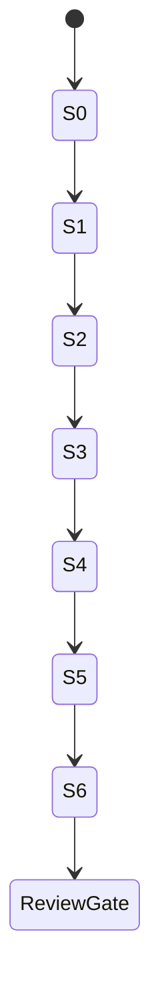

# Signup Phase B Implementation Slices

> Design proposal for human review, 2026-10-12. Baseline:
> `a0bd2d7ff6499e393a3dabb46617f6292f23c84e` (merged documentation PR #10).
> No Phase B behavior is implemented or approved by this document.
> `SIGNUP_ENABLED=false`; AUTH-001 remains incomplete; production readiness is not established.

## Authorization and dependency order

This is a future delivery plan. This task authorizes design documentation and a draft
PR only, not these source changes. Obtain explicit approval of the relevant decisions
and first slice before implementation. Keep signup disabled throughout implementation.
Each slice gets its own reviewable PR, narrow acceptance evidence and security tests.
Do not merge a later slice merely because earlier historical CI passed.

| Slice / dependencies | Narrow change boundary | Acceptance and required security tests | Rollback strategy |
| --- | --- | --- | --- |
| S0 Test-only characterization complete | Existing Draft PR #12 unchanged/unmerged at pinned head; nine real cases / zero skips in CI #28 | Real ACK-loss/witness, abort, ROLLBACK tag, post-ACK release fault, MVCC and backend disposal characterized. Two unsafe owner behaviors remain confirmed defects | Preserve historical evidence; no runtime changes or automatic merge |
| S1 Outcome-aware owner; S0 evidence complete, pending D06 and explicit S1 authorization | Only DB owner/types and owner/admission tests; no T1/T2/T3 service/HTTP or expiry schema | D06 typed evidence/proof/cleanup model; correct real ROLLBACK-tag false success and post-ACK cleanup masking; future regressions must fail old owner. READ COMMITTED, bounded acquisition/cancellation/late checkout, stalled COMMIT, one aggregate teardown target, no unowned operations. F07-F13/F17/F25/F27 | Signup stays off; revert only while no keyed writer enabled; preserve ledger and S0 defect evidence |
| S2 Secure binding/reservation; requires S1 and D03/D04/D07 approval | Secure startup injection plus internal T1; no public header activation. D04 A requires a separately reviewed schema/grant ADR and explicit rescope before terminalization code | Frozen crypto vectors, no secret fallback/logging, attestation/fleet gate, independent claim commit, immutable expiry and F24 ACK loss; selected D04/P08 clock/terminality contract, not a timestamp-only permanent-expiry claim | Disable entry/config; preserve ledger/secret; no terminal-state deletion or policy reset shortcut |
| S3 PostgreSQL capacity gate; requires S1 and approved D05/D08 | Internal fixed namespace/four transaction advisory slots; no schema/migration/grant change | All lock-capable T1/T2/T3 transactions acquire slot before claim; nonblocking bounded acquisition; restricted-role builtin works without broadened privilege. F09/F15/F16/F23/F26 | Keep signupoff; remove gate only after capacity-policy review, not as a workaround for permission failures |
| S4 Internal orchestration; requires S2/S3, D10/D12 and selected D04/D06 integration | Keyed service path, exact duplicate handling, atomic result and no-write T3; terminalization only if separately approved under D04 | T2 continuous lock/fresh SELECT; U/P/A/R atomicity; T3 request-owned accepted latch survives catch/finally/rollback/end/release/Redis/disconnect, no proof -> controlled failure; T3 never writes domain/result/terminal facts | Disable entry, drain owned work with evidence, preserve ledger; no unkeyed fallback against retained claims |
| S5 HTTP contract; requires S4, D01/D02/D06 | Header guard, DTO error mapping, response/cache policy, body/header bounds, cancellation wiring and HTTP tests | Exact202 for new/duplicate/replay; raw duplicate parsing; mandatorykey; stable400/409/429/503/500/413/415; guard/rate/admission order. P01 plus real proxy/parser and Unicode fixtures | Keep defaultoff; disable endpoint before any rollback, retain ledger/secret; client contract revision requires explicit coordination |
| S6 Adversarial/operational review; requires S5, D08/D11/D13 and chosen expiry policy | Test harnesses, threat/decision updates and runbook; no automatic production/role adoption | F01-F28, T01-T17, lost ACK/Redis stalls/deadlocks/failover, selected D04 backward-clock/terminalization tests, storage/hash/timing, exact-head CI. Independent human review required | Stop enabled-development testing on unresolved issue; retain evidence/ledger; no deployment/cleanup/rotation fallback |

If D05 selects another architecture, rewrite S3 and re-review its proof before S4. A
sixth table, broader UPDATE, owner runtime account, or Redis-as-PG-fence is not a routine
implementation variation. Secure injection requires approved secret-manager/config
mechanism; a hardcoded or environment-fallback secret is never an acceptable temporary slice.

## Updated readiness gate

S0 is characterization complete at [PR #12](https://github.com/ryukkfk/authcore/pull/12)
head `822062fea79fad3e5a8547dc9f7b40b999f7cb71`,
[CI #28](https://github.com/ryukkfk/authcore/actions/runs/38232288230), nine real
cases / zero skips. Historical KNOWN GAP passes are not fixed-owner acceptance.
S1 is **not authorized**: owner must approve the concrete
[D06 record](Signup%20Phase%20B%20D06%20Decision.md) and S1 slice scope.
[D04 record](Signup%20Phase%20B%20D04%20Decision.md) remains an independent
S2/expiry integration gate; option A changes the future five-table plan only after
explicit schema/permission review. No S0 PR merge is inferred.

## Slice review checklist

- State approved decision IDs, exact base/head, changed files and observable contract.
- Run relevant existing regressions plus new meaningful security tests; record skipped/
  blocked results and exact CI provenance. Preserve original350 baseline as historical.
- Keep five-table grants, CHECK-constrained `UPDATE(lock_anchor)`, immutable results/audit,
  HMAC v1 vectors and defaultoff unchanged unless a separately approved future design says otherwise.
- Review before/after lock schedules and failure branches; no missing-result rollback
  inference, no recursive account retry and no pending202.
- Describe rollback while retained claims exist; no ledger deletion, key rotation or
  old/new writer overlap to make a rollback easier.

## Work deliberately outside the first implementation chain

Automatic cleanup, finite replay retention, HMAC rotation/cross-version migration,
owner maintenance, account deletion/audit retention, registration/email verification,
hard global hash-worker coordination, live credential adoption, public signup and
production operational validation need separate designs and authorization. They remain
launch blockers even if Phase B idempotency tests pass. This plan does not mark AUTH-001 complete.

The next coding approval is **D06 and the narrowly scoped S1 owner slice**.
D04 A/B/C and D01/D03/D05/D07/D08/D10 remain separate later-slice decisions. Approval of a design draft is not independent
security sign-off. See [Decision Register](Signup%20Phase%20B%20Decision%20Register.md),
[Test Plan](Signup%20Phase%20B%20Test%20Plan.md), and
[Architecture](Signup%20Phase%20B%20Architecture.md).
