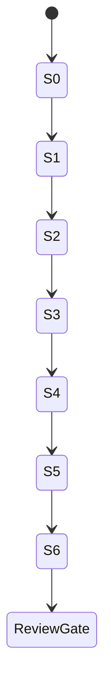

# Signup Phase B Implementation Slices

> Design proposal for human review, 2026-10-12. Baseline:
> `a0bd2d7ff6499e393a3dabb46617f6292f23c84e` (merged documentation PR #10).
> No Phase B behavior is implemented or approved by this document.
> `SIGNUP_ENABLED=false`; AUTH-001 remains incomplete; production readiness is not established.

## Authorization and dependency order

This is a future delivery plan. This task authorizes design documentation and a draft
PR only, not these source changes. Obtain explicit approval of the relevant decisions
and first slice before implementation. Keep signup disabled throughout implementation.
Each slice gets its own reviewable PR, narrow acceptance evidence and security tests.
Do not merge a later slice merely because earlier historical CI passed.

| Slice / dependencies | Narrow change boundary | Acceptance and required security tests | Rollback strategy |
| --- | --- | --- | --- |
| S0 Test-only transaction outcome harness; first recommended slice | Disposable DB/proxy test infrastructure and characterization tests only; no production service/controller/permissions/SQL changes | Prove committed-but-ACK-lost and definite-abort branches, command ROLLBACK tag, late lock/fresh lookup, cleanup-after-ACK behavior. F10/F24/F25/F27. If current behavior fails, retain an explicit characterization/known-gap test rather than weaken assertion | Remove test harness only if defective; preserve discovered issues and evidence; no runtime/data rollback needed |
| S1 Outcome-aware transaction owner; requires S0, D06 | Only DB transaction owner/types and owner/admission tests; preserve timeout/SQLSTATE/transport ownership | Explicit COMMIT phase/tag and committed latch; READ COMMITTED; bounded acquisition/late-client disposal/actual teardown; no unowned pending operations. F07-F13/F17/F25/F27 | Feature remainsoff; revert owner code only while no keyed writer is enabled; never delete claims/results |
| S2 Secure binding and reservation service boundary; requires S1, D03/D04/D07 | API startup secret injection/config validation plus internal T1 reservation abstraction; no public header activation | Exact frozen crypto vectors unchanged; no fallback/logging; known-answer/fleet gate mechanism approved; independent T1 commit, original expiry retained, clock-skew failclosed, T1 ACK-loss handling. F04/F06/F18-F20/F24 | Disable entry/config and revert wiring; preserve all durable claims and same secret/version for future reconciliation |
| S3 PostgreSQL capacity gate; requires S1 and approved D05/D08 | Internal fixed namespace/four transaction advisory slots; no schema/migration/grant change | All lock-capable T1/T2/T3 transactions acquire slot before claim; nonblocking bounded acquisition; restricted-role builtin works without broadened privilege. F09/F15/F16/F23/F26 | Keep signupoff; remove gate only after capacity-policy review, not as a workaround for permission failures |
| S4 Internal account/result orchestration; requires S2/S3, D10/D12 | SignupService internal keyed path and precise duplicate handling, result atomicity and no-write recovery; no public enabled endpoint | T2 continuous claim lock, separate result SELECT, U/P/A/R atomicity; legacy duplicate result without credential/audit change; all internal callers participate; T3 bounded no-domain-write. F01-F13/F17/F19-F21/F23-F25 | Disable keyed entry and drain owned operations with server evidence; preserve ledger. Do not revert to unkeyed writers against retained claims |
| S5 HTTP contract; requires S4, D01/D02/D06 | Header guard, DTO error mapping, response/cache policy, body/header bounds, cancellation wiring and HTTP tests | Exact202 for new/duplicate/replay; raw duplicate parsing; mandatorykey; stable400/409/429/503/500/413/415; guard/rate/admission order. P01 plus real proxy/parser and Unicode fixtures | Keep defaultoff; disable endpoint before any rollback, retain ledger/secret; client contract revision requires explicit coordination |
| S6 Adversarial multi-process validation and operational review; requires S5, D08/D11/D13 | Test harnesses, threat/decision updates and runbook only; no automatic production/role adoption | F01-F28, T01-T16 mapped evidence, lostACK/proxycrash/Redisstalls/deadlock/denial/failover characterization, storage/hash capacity and timing results, exact-head CI. Independent human review required | Stop enabled-development testing on unresolved safety issue; retain evidence/ledger; no deployment/cleanup/rotation fallback |

If D05 selects another architecture, rewrite S3 and re-review its proof before S4. A
sixth table, broader UPDATE, owner runtime account, or Redis-as-PG-fence is not a routine
implementation variation. Secure injection requires approved secret-manager/config
mechanism; a hardcoded or environment-fallback secret is never an acceptable temporary slice.

## Slice review checklist

- State approved decision IDs, exact base/head, changed files and observable contract.
- Run relevant existing regressions plus new meaningful security tests; record skipped/
  blocked results and exact CI provenance. Preserve original350 baseline as historical.
- Keep five-table grants, CHECK-constrained `UPDATE(lock_anchor)`, immutable results/audit,
  HMAC v1 vectors and defaultoff unchanged unless a separately approved future design says otherwise.
- Review before/after lock schedules and failure branches; no missing-result rollback
  inference, no recursive account retry and no pending202.
- Describe rollback while retained claims exist; no ledger deletion, key rotation or
  old/new writer overlap to make a rollback easier.

## Work deliberately outside the first implementation chain

Automatic cleanup, finite replay retention, HMAC rotation/cross-version migration,
owner maintenance, account deletion/audit retention, registration/email verification,
hard global hash-worker coordination, live credential adoption, public signup and
production operational validation need separate designs and authorization. They remain
launch blockers even if Phase B idempotency tests pass. This plan does not mark AUTH-001 complete.

The next requested approval should be **S0 test-only COMMIT outcome characterization**
plus review of D01/D03/D04/D05/D06/D08/D10. Approval of a design draft is not independent
security sign-off. See [Decision Register](Signup%20Phase%20B%20Decision%20Register.md),
[Test Plan](Signup%20Phase%20B%20Test%20Plan.md), and
[Architecture](Signup%20Phase%20B%20Architecture.md).
