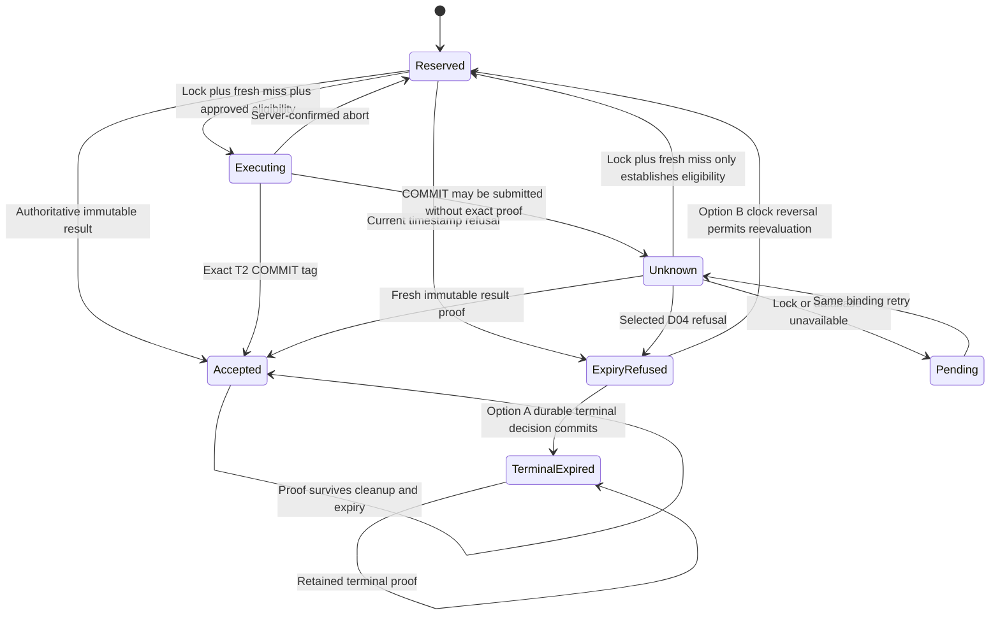

# Signup Phase B Recovery and Fencing

> Design proposal for human review, 2026-10-12. Baseline:
> `a0bd2d7ff6499e393a3dabb46617f6292f23c84e` (merged documentation PR #10).
> No Phase B behavior is implemented or approved by this document.
> `SIGNUP_ENABLED=false`; AUTH-001 remains incomplete; production readiness is not established.

## Safety argument and evidence boundaries

Every participating writer holds the retained claim's PostgreSQL row lock continuously
from a separate fresh result read through domain/result writes and transaction end.
No owner deletes/rebinds claims, HMAC identity stays fixed, and recovery uses one trusted
authoritative primary lineage. Acknowledged-data loss, forged INSERTs or mixed writers
break these assumptions; S0 did not validate them operationally.

[S0 evidence](Signup%20Phase%20B%20Test%20Plan.md#s0-verified-evidence) distinguishes
real PostgreSQL observations from injected faults and future controls. S0-01/05 show
complete server COMMIT completion followed by proxy-withheld ACK and a new independent
committed witness. S0-02 shows real server error/ROLLBACK and absent owned writes.
S0-03/04 confirm current owner defects, not safe behavior. S0-06 verifies both writer
outcomes and the negative same-statement JOIN. S0-07 verifies ordinary failed-backend
eviction, not all function-owned deadlines.

Explicit READ COMMITTED: acquire SELECT FOR UPDATE, then issue a separate result SELECT.
A same-statement JOIN can retain a pre-wait snapshot and miss a newly committed result.
After a conforming lock barrier and fresh miss, execution eligibility is valid only
while the unchanged lock remains held, subject to selected D04/admission policy.
It is not a universal classification of which earlier attempt rolled back.
An unlocked miss, Redis lease expiry, process death or local socket closure proves
neither historical rollback nor that a previously sent COMMIT failed.
[PostgreSQL isolation](https://www.postgresql.org/docs/17/transaction-iso.html) and
[locking](https://www.postgresql.org/docs/17/explicit-locking.html) support the protocol.

## Proposed typed owner, proof latch and error precedence

The normative proposed model is the pending
[D06 decision record](Signup%20Phase%20B%20D06%20Decision.md).
It separates transaction outcome (NOT_SUBMITTED, ABORT_CONFIRMED, COMMIT_UNKNOWN,
COMMIT_ACK, COMMIT_ROLLBACK), accepted business proof, and cleanup health.
These are proposed internal types; no source/API changes exist in this PR.

Set COMMIT_UNKNOWN conservatively before dispatch can occur; require the exact COMMIT
tag to establish COMMIT_ACK. A resolved ROLLBACK tag means COMMIT_ROLLBACK and must not
return work success. SQLSTATE-only or a later no-op ROLLBACK is not a universal classifier.
T1 COMMIT proves reservation only. Exact T2 COMMIT plus atomic accepted-result writes,
or a validated fresh authoritative immutable result, establishes business acceptance.

Maintain NONE -> ACCEPTED as a monotonic request-level proof latch outside transaction
callback and catch/finally. Validate matching claim ID/frozen binding, exact result
version/body and primary lineage before latching. No result from the reader's own
uncommitted writes counts as authoritative replay proof. A later cleanup failure,
ROLLBACK, cancellation, Redis error or disconnect cannot downgrade accepted proof.
The original attempt's history can remain unknown even though accepted persistence
is now proven. No proof is manufactured from callback return or query-promise resolution.

Freeze the primary operation/server SQLSTATE with phase before cleanup; preserve it
over rollback/end/release errors, keeping cleanup diagnostics separately.
After valid proof, business response is exact generic 202 if deliverable regardless
of cleanup health. Before proof, integrity/permission errors map safely, synchronized
selected-D04 refusal may map to 409, transient/unknown maps to controlled 503.
COMMIT_ROLLBACK never returns callback success; an unexplained tag is invariant 500,
a confirmed transient abort is 503. Failed no-proof recovery cleanup yields 503.
Response delivery is separate from durable outcome.

## Ownership and proposed budgets

[D06 ownership rules and budget table](Signup%20Phase%20B%20D06%20Decision.md#budget-reconciliation-and-recommended-targets)
reconcile the current 5s pool acquire, 1/5/15/3s lock/statement/transaction/idle constants
and 1s teardown constant with future owner deadlines.
T1/T2 preserve server lock/statement/transaction/idle targets; propose a function-owned
1s acquisition and one aggregate disposal budget. T3 is a separate profile:
1s acquisition + 3s transaction (500ms lock, 1s statement/idle) + 1s aggregate disposal,
nominal 5s. The former equal 1s lock/statement proposal could not guarantee lock-timeout
precedence. Do not globally change constants or call two sequential cleanup timers one second.

Actual acquisition/query/transport operations remain owned until cancellation/settlement,
or explicitly quarantined under a cleanup owner while local capacity stays reserved.
Late checkouts never BEGIN/work after cancellation; they are disposed once.
No healthy idle return with a pending query; no abandoned Promise.race, unobserved
rejection, repeated release or detached domain retry. Abort before COMMIT dispatch;
after possible dispatch, cancellation does not erase uncertainty. Evict failed/fatal/
unknown clients. A release fault must not reproduce S0-04 checkout retention.

Timeout targets need future driver/real-backend acceptance. Server statement completion
does not bound ACK delivery. No hard whole-request bound is proven under event-loop/OS
stalls, native Argon2, partition or shutdown. Local closure is not server rollback proof.
If recovery's remaining response budget is insufficient, skip it and return 503 without
starting new work; retain ownership of any actual pending cleanup.

## Corrected T2 and T3 pseudocode (proposed, unimplemented)

At most one fresh T3 per request, after the original transport is locally settled and
cannot send further work. T3 acquires capacity then the known claim, uses a separate
fresh SELECT and never hashes/reserves/writes domain, accepted result or expiry state.
It is a normal transaction, not SQL READ ONLY, because row locking is required.
D04 terminalization, if separately approved, belongs to a normal policy-owning writer.

```text
handle(request):
  validate_guards_header_DTO_and_admit()
  proof = NONE                         # request-owned, never cleared by cleanup
  binding = frozen_v1_HMAC(validated_input)
  claim = independently_commit_or_prove_T1_reservation(binding)
  # T1 COMMIT/claim proof alone is not signup acceptance.
  if validated_authoritative_result_seen_in_T1:
    latch_accepted(proof, immutable_result)
  if proof.accepted: return exact_202_if_connected
  hash = active_hint_under_selected_D04 ? Argon2(validated_password) : none
  T2_record = owned_T2(READ_COMMITTED, external_proof_latch=proof):
    acquire_capacity_then_known_claim_and_verify_id_binding()
    result = separate_fresh_result_statement()
    if valid_authoritative_result(result):
      latch_accepted(proof, result)      # BEFORE ending T2 or releasing resources
      end_read_path_without_domain_writes()
    else:
      eligibility = selected_D04_under_same_lock()
      if eligibility != ACTIVE: end_without_domain_writes(eligibility)
      else:
        assert_admission_and_not_cancelled()
        require_hash_or_abort_without_hashing_inside_T2()
        create_user_or_precise_duplicate_path_with_required_credential_audit()
        insert_accepted_result()
        mark_commit_dispatch_unknown_before_query()
        tag = send_single_COMMIT_and_await_completion()
        if tag == COMMIT:
          record_COMMIT_ACK()
          latch_accepted(proof, validated_atomic_T2_work)
        else if tag == ROLLBACK: record_COMMIT_ROLLBACK()
        else: record_COMMIT_UNKNOWN_protocol_failure()
    # owner catches failures and disposes; never downgrades external proof
  if proof.accepted: return exact_202_if_connected
  if T2_record.policy_refusal_and_cleanup_healthy: return selected_D04_response
  if T2_record.definite_abort_or_not_submitted: return safe_mapped_failure
  return recover_without_domain_writes(claim, binding, proof)

recover_without_domain_writes(claim, binding, proof):
  owner = bounded_owner_for_one_T3_attempt()
  primary = NONE
  refusal = NONE
  cleanup = NOT_STARTED
  try:
    owner.acquire_or_cancel_with_late_checkout_disposal()
    owner.BEGIN_READ_COMMITTED_and_install_T3_profile()
    owner.acquire_capacity_then_lock_known_claim()
    verify_unchanged_claim_id_and_frozen_binding()
    result = separate_fresh_authoritative_result_statement()
    if valid_authoritative_result(result):
      latch_accepted(proof, result)      # outside owner; cannot be unset
    else:
      refusal = read_selected_D04_policy_without_writes()
      # A: terminal proof -> refusal; timestamp-only expiry without fact -> unresolved
      # B: current predicate refusal only; never claim permanent terminality
    owner.finish_read_transaction_with_bounded_ROLLBACK()
    # This ROLLBACK ends T3, not proof about the original unknown T2.
  catch error:
    primary = freeze_correlated_primary(error)
    # NO RETURN HERE; later cleanup errors must not bypass proof selection.
  finally:
    try:
      cleanup = owner.dispose_and_observe_pending_operations_once()
    catch cleanup_error:
      cleanup = owner.quarantine_and_retain_capacity_no_throw(cleanup_error)
      # Must not throw over proof; health and durable business outcome stay separate.
    record_allowlisted_cleanup_health_no_throw_no_payloads(primary, cleanup)
  if proof.accepted:
    record_proof_success_no_throw_independently_of_cleanup_health()
    return exact_202_if_connected
  if primary != NONE and primary.is_permission_or_unexpected_invariant: return safe_fixed_500
  if primary != NONE or cleanup not healthy: return fixed_503_retry_after_1
  if refusal.valid_under_selected_D04: return fixed_409
  return fixed_503_retry_after_1
```

All helper names are future contracts, not implemented functions. Cleanup envelopes and
telemetry epilogues must not throw over latched proof; quarantine retains ownership and
records degraded health even if logging fails. Healthy disposal means confirmed local settlement/eviction with no unresolved cleanup fault; intentional settled eviction alone is not a failure. Process-fatal faults can prevent delivery,
not undo the committed database result. dispose/quarantine
must own actual operations and report health accurately; silently swallowing cleanup
without eviction/ownership is forbidden. A latched accepted proof takes precedence
through catch, finally, rollback, end and release, including errors raised after proof.
No-proof failure remains controlled, not a fabricated success. Full T3 service/HTTP
acceptance is S4/S5; S1 adds owner-level proof-envelope security regressions.

Allowlisted operational reason counters include outcome=commit_ack/commit_unknown/
commit_rollback/result_proof and cleanup=clean/evicted/quarantined/release_failure.
Emit independent cleanup-health alerts and bound/quarantine capacity; never append a
duplicate domain audit/result merely to log cleanup. No raw SQL/errors, keys, binding
digests, passwords, hashes, tokens or connection URLs in telemetry. Disconnection may
prevent HTTP delivery without changing the durable result.



These are logical distinctions, not approved database columns. Option A terminal
state needs a separate schema/grant review; option B refusal is explicitly reversible.
Without a selected D04 policy the expiry execution path remains blocked.

## Redis lease and PostgreSQL fencing

Verified baseline admission uses Redis TIME, UUID lease tokens, 30s TTL, 10s renewals,
no resurrection, exact-token release and bounded transport retirement. It does not
atomically fence PostgreSQL COMMIT. A worker may stall after its last lease check,
lose Redis ownership and still execute an already queued COMMIT.

Claim locking serializes the same retained key, not different keys or global Argon2.
Proposed transaction-level PostgreSQL capacity slots remain held until server
transaction end; they do not provide lease-valid-at-COMMIT or a hard fleet hash cap.
Observed pre-dispatch lease loss cancels work; after possible COMMIT dispatch,
classify/recover. Valid accepted proof survives later Redis cleanup failure.
[Redis locking assumptions](https://redis.io/docs/latest/develop/clients/patterns/distributed-locks/)
remain an operational boundary.

## Crash points, expiry and maintenance

| Crash point | Durable state / proposed recovery |
| --- | --- |
| Before/around T1 COMMIT | Claim absent, invisible or committed; prove matching retained identity before account work |
| After T1, before hashing/T2 | Orphan retained claim; later approved-policy execution requires lock/fresh read |
| During T2 writes, before COMMIT dispatch | Writes uncommitted; no immediate rollback inference from socket death; server abort/lock barrier matters |
| COMMIT in flight | Original outcome unknown until correlated evidence; fresh result can prove acceptance |
| After T2 COMMIT before HTTP response | Retained accepted result permits replay; delivery separate |
| During T3 before proof | No writes; controlled 503 and future same-binding retry |
| During T3 after proof | Accepted conclusion preserved despite rollback/release/teardown failure; cleanup health independently degraded |
| During option A terminalization (future) | Unknown ACK requires authoritative terminal proof, not a volatile expired observation |

[D04](Signup%20Phase%20B%20D04%20Decision.md) compares durable terminalization,
explicitly non-monotonic timestamp policy and alternative time/epoch protocols.
clock_timestamp() after waiting fixes stale transaction-start time; it does not create
permanent monotonic expiry. Preserve immutable binding/expiry, result-first checks,
late authorized commits, no rebinding and no cleanup. Recommended A is conditional
on an approved state/grant extension; none is made here. T3 remains read-only in
domain/state effects under every option.

Initially retain all claims/results and any future terminal facts. Safe automatic
cleanup eligibility is empty. Deletion or HMAC namespace changes can permit rebinding;
temporary drain/locks do not prevent late reuse after traffic resumes. Future cleanup
needs durable anti-rebinding or permanent namespace retirement, privacy review,
all-writer quiescence and lineage evidence. Runtime history UPDATE/DELETE stays denied.

One frozen active HMAC secret/version per retained namespace; no automatic rotation
or plaintext retention. Known-answer/fleet attestation is proposed, not implemented.
On detected drift/leak, stop new signup and preserve evidence; credential response
requires separate authority. The ledger cannot detect an unknown changed namespace.

References: [PostgreSQL WAL](https://www.postgresql.org/docs/17/runtime-config-wal.html),
[timeouts](https://www.postgresql.org/docs/17/runtime-config-client.html),
[time semantics](https://www.postgresql.org/docs/17/functions-datetime.html).
See [Architecture](Signup%20Phase%20B%20Architecture.md),
[Threat Review](Signup%20Phase%20B%20Threat%20Review.md),
[Test Plan](Signup%20Phase%20B%20Test%20Plan.md),
[Decision Register](Signup%20Phase%20B%20Decision%20Register.md).
