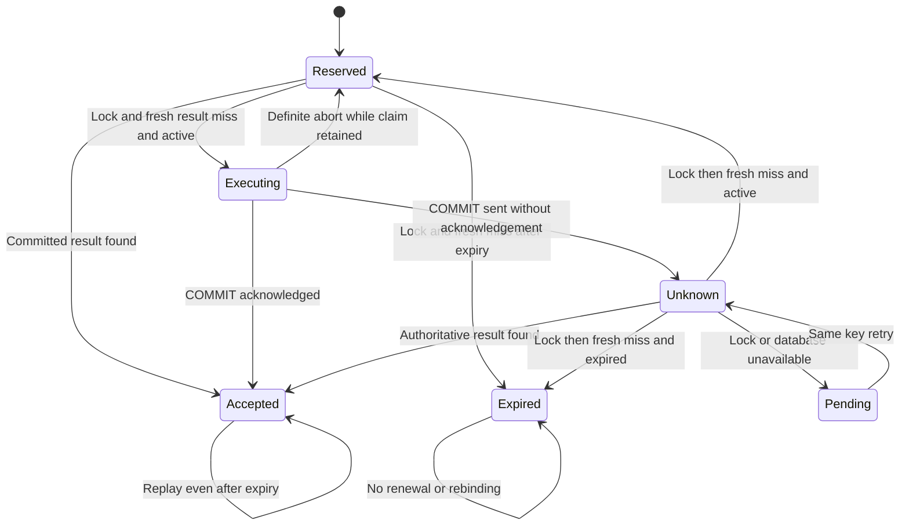

# Signup Phase B Recovery and Fencing

> Design proposal for human review, 2026-10-12. Baseline:
> `a0bd2d7ff6499e393a3dabb46617f6292f23c84e` (merged documentation PR #10).
> No Phase B behavior is implemented or approved by this document.
> `SIGNUP_ENABLED=false`; AUTH-001 remains incomplete; production readiness is not established.

## Safety argument and its prerequisites

The execution authority is the retained claim's PostgreSQL row lock. Every writer must
hold it continuously from a separate fresh result read through domain writes, result
INSERT and transaction end. PostgreSQL serializes these writers. No owner deletes or
rebinds claims; no HMAC namespace drift; recovery uses the authoritative primary with
acknowledged-data durability. If these prerequisites fail, this proof does not apply.

Under explicitly selected READ COMMITTED, acquire `SELECT ... FOR UPDATE` first, then
issue a new statement for the result. A join/result read in the same statement that
waited for the lock can use a pre-wait snapshot and miss a just-committed result. Never
use that pattern. [PostgreSQL isolation](https://www.postgresql.org/docs/17/transaction-iso.html)
and [locking](https://www.postgresql.org/docs/17/explicit-locking.html) explain these boundaries.

After recovery acquires the unchanged claim lock, earlier conforming writers have ended.
A fresh missing result then establishes **safe execution eligibility while the new lock
is held**, subject to expiry/admission. It does not establish which earlier attempt
rolled back. If the lock is released, eligibility must be re-established under a new
lock. A plain missing SELECT, expiry, Redis release or socket closure establishes neither.

## Proposed outcome-aware transaction owner

The current [owner](../../packages/db/src/signup-transaction.ts) throws raw primary errors
and evicts failed connections, but does not expose whether COMMIT was sent/acknowledged.
It also permits a release error to mask acknowledged success. Introduce a typed internal
outcome only after tests; do not infer it from HTTP errors or string matching.

| State/evidence | Permitted conclusion | Action |
| --- | --- | --- |
| COMMIT not submitted; authoritative server abort or completed rollback of this transaction | Definite non-commit of this attempt | Return mapped failure; later same-key retry can lock/check again |
| COMMIT not submitted; transport gone without server termination evidence | No COMMIT was intentionally sent, but backend may still hold locks/work | Stop sending work, settle transport; later lock acquisition is the synchronization barrier |
| COMMIT submitted, no verified success response | Unknown, even if a later ROLLBACK command succeeds | Evict/settle original connection; bounded independent recovery |
| Verified successful COMMIT command completion | Committed according to approved durability profile | Latch accepted result; later pool/Redis release failures cannot turn it into a failed signup |
| COMMIT completes with ROLLBACK command tag | Transaction did not commit | Never convert a resolved query promise alone into success |
| Fresh authoritative immutable result for matching retained claim | Committed accepted response, including duplicate-email path | Replay exact 202; no new domain work |
| Claim lock acquired, separate result read missing | No earlier conforming writer can subsequently commit without reacquiring this row | Recovery does not write; normal future retry may execute only after locking/checking again |
| Lock unavailable, DB unavailable, claim missing/replaced, or uncertain primary lineage | Unresolved/integrity unavailable | 503, no replacement claim, no success fabrication |

The adapter must verify command completion/tag and preserve first SQLSTATE plus outcome
phase before cleanup. A SQLSTATE alone is not a universal COMMIT classifier: deadlock or
serialization abort is definitive only with transaction/command evidence. ROLLBACK
after lost COMMIT ACK can be a no-op in a new idle state. Local `end()`/destroyed socket
prevents further client writes but does not prove backend rollback. Never resend COMMIT
or execute account work recursively because cleanup appeared successful.

Use the same checked-out connection for each transaction, as required by
[node-postgres](https://node-postgres.com/features/transactions). No detached pending
query may outlive ownership. A timeout must settle/cancel the actual transport and
dispose of a late acquired client, not merely `Promise.race` a pending operation.

## Bounded recovery protocol (proposed)

At most one fresh recovery attempt per HTTP request, after original transport settlement.
Proposed recovery budget: connection acquisition at most 1 second, row lock at most
1 second, statement at most 1 second, whole recovery transaction at most 3 seconds,
idle transaction at most 1 second, teardown at most existing 1 second. These are targets
for a tested owner/adapter, not current pool settings. No wait is unbounded; inability
to acquire/settle within the response budget returns 503 and retains local admission
until actual work/transport settles. Cleanup cannot launch an unowned background retry.
Recovery acquisition plus transaction plus teardown has a proposed maximum 5-second
budget; nested lock/statement deadlines fit inside it. Skip recovery and return503 if
the remaining response budget cannot accommodate it. No hard whole-request latency is
claimed for native Argon2/process stalls; local admission stays occupied until that work
settles, even after a client disconnect.

T3 is a normal transaction with **no domain/result writes**, not SQL `READ ONLY`:
PostgreSQL row locking is needed. It acquires one capacity slot before the known claim.
It never reserves a substitute claim, hashes a password or creates a user. A committed
result observed during T3 remains authoritative even if ending this no-domain-write
transaction fails; release its lock/transport safely and replay accepted success.

```text
handle(request):
  validate_guards_header_DTO_and_admit()
  binding = frozen_v1_HMAC(validated_input)
  claim, positive_result = independently_commit_T1_reservation(binding)
  # If T1 ACK is lost: bounded primary lookup; matching durable claim required.
  if positive_result: return exact_202
  hash = claim_appears_active ? Argon2(validated_password) : none
  outcome = T2_on_one_client(READ_COMMITTED):
    acquire_one_fixed_capacity_slot_or_abort()
    row = lock_known_claim_and_verify_id_binding()
    result = separate_fresh_result_statement(row.id)
    if result: return REPLAY_WITHOUT_WRITES
    if row.expires_at <= database_clock_timestamp(): return EXPIRED_WITHOUT_WRITES
    assert_valid_admission_and_not_cancelled()
    require_hash_or_abort_without_writes()
    try: user = create_user_with_targeted_unique_conflict_handling()
    catch DuplicateUserEmailError: user = none
    if user:
      insert_credential(user, hash)
      insert_mandatory_creation_audit(user)
    insert_accepted_result(row.id)
    commit_and_classify()
  if outcome.committed or outcome.proven_replay: return exact_202
  if outcome.expired_without_writes: return fixed_409
  if outcome.definitely_aborted: return safe_mapped_failure
  return recover_without_domain_writes(claim, binding)

recover_without_domain_writes(claim, binding):
  try T3_with_one_attempt_and_bounded_owner(READ_COMMITTED):
    acquire_one_fixed_capacity_slot_or_abort()
    row = lock_known_claim_and_verify_id_binding()
    result = separate_fresh_result_statement(row.id)
    if result: latch PROVEN_ACCEPTED
    else if row.expires_at <= database_clock_timestamp(): latch EXPIRED
    else: latch RETRYABLE_WITHOUT_HISTORICAL_ROLLBACK_CLAIM
  catch unresolved: return fixed_503_retry_after_1
  if PROVEN_ACCEPTED: return exact_202
  if EXPIRED: return fixed_409
  return fixed_503_retry_after_1
```

Pseudocode describes future boundaries, not existing function signatures. An expired
hint that becomes active due to clock correction cannot start writes without a hash;
abort that attempt safely and retry rather than hash while holding T2. Positive committed
result proofs are latched before cleanup so a later cleanup failure cannot erase them.
No account-work retry happens within recovery; client retry reacquires every prerequisite.



These are logical states, not new mutable database columns. Reserved/Unknown/Pending
can look identical in an unlocked ledger read. Do not synthesize a stored success from
the state diagram. An authorized pre-expiry writer may commit later; therefore always
check the result under the acquired lock before rejecting an expired claim.

## Redis lease and PostgreSQL fencing

Verified Redis admission uses Redis TIME and a sorted set, UUID lease tokens, 30-second
TTL, 10-second renewal, no resurrection after expiry, exact-token release and bounded
transport retirement. Rate limits are atomically evaluated inside Redis only. None of
these operations atomically fences PostgreSQL COMMIT.

Counterexample: worker A checks its lease, stalls after its last check, Redis expires A,
worker B gets a slot, A's already queued COMMIT executes. A cannot be prevented from
committing by Redis expiry alone. Claim-row serialization stops B from double-executing
**the same key**, not from executing another key or increasing global Argon2 concurrency.
Transaction-level PostgreSQL slots are retained until actual server transaction end;
they prevent participating PostgreSQL capacity from being freed just by a Redis expiry.
They do not stop a pre-expiry admitted writer from completing, and do not provide an
exact lease-valid-at-COMMIT guarantee. That guarantee is deliberately not promised.

If lease loss is observed before COMMIT, abort without accepted result; if COMMIT has
already been submitted, classify/recover. Expiry never authorizes a replacement writer
to bypass the row lock. Cancellation has the same boundary. Redis failover can lose
quota/lease state; PostgreSQL identity still serializes per key while the approved
primary lineage survives. Availability is sacrificed on Redis command uncertainty.
See [Redis locking assumptions](https://redis.io/docs/latest/develop/clients/patterns/distributed-locks/).

## Crash points, expiry and maintenance

| Crash point | Durable state and recovery |
| --- | --- |
| Before T1 commit | Claim may be absent, invisible or committed if ACK was lost; reserve/recheck with same binding, never assume absence proves rollback |
| After T1 commit, before hashing/T2 | Orphaned claim, no success; next active retry can execute under lock |
| After user/credential/audit/result INSERT before COMMIT | Uncommitted writes invisible; retry waits for row lock; server abort removes all T2 writes |
| COMMIT in flight | Accepted result may commit or all T2 writes may abort; fresh lock/read resolves eligibility or proves success |
| After COMMIT before HTTP delivery | Retained result proves accepted; replay has no duplicate domain effects |
| During recovery | No domain writes; terminate/settle, then later same-key request repeats bounded proof |

Proposed D04 expiry is a 24-hour execution-start window; duration requires approval.
Use `clock_timestamp()` after lock wait, not transaction-start `now()` for that decision.
The Phase A reservation API still checks application time and the database CHECK; clock
disagreement fails closed, never extends existing expiry. Expiry does not imply rollback.

Initially retain all claims/results, including expired and unresolved ones. Safe automatic
cleanup eligibility is **empty**. Finite retention would forget an old raw key, allowing
late retries to rebind; locks and a temporary maintenance drain alone do not prevent
that after traffic resumes. A future owner-managed cleanup protocol needs durable
tombstones or permanent namespace retirement, reviewed retention/account deletion policy,
all-writer quiescence and primary lineage evidence. Only then can owner-controlled
result-before-claim deletion respect the FK. Runtime DELETE/UPDATE privileges stay denied.

One active HMAC secret/version is frozen for the entire retained namespace. A wrong
secret or new version changes identity and can evade old claims; the ledger cannot
detect this. Require trusted immutable version/material injection, independent known-answer
configuration attestation and fleet consistency before enabling Phase B. Detected mismatch
fails closed; undetected compromise remains a critical residual risk. Old HMAC digests
cannot be rehashed into a new secret without unavailable plaintext. Do not store raw
keys/passwords to enable rotation. Cross-version reservation/reconciliation is a separate
design. On suspected leakage stop new signup and preserve evidence; no automatic rotation
or ledger deletion. Credential/secret response actions require separate operational authority.

Durability and failover prerequisites follow
[PostgreSQL WAL configuration](https://www.postgresql.org/docs/17/runtime-config-wal.html).
Timeouts follow [client settings](https://www.postgresql.org/docs/17/runtime-config-client.html);
current-time semantics follow [date/time functions](https://www.postgresql.org/docs/17/functions-datetime.html).
See [Threat Review](Signup%20Phase%20B%20Threat%20Review.md),
[Test Plan](Signup%20Phase%20B%20Test%20Plan.md) and
[Decision Register](Signup%20Phase%20B%20Decision%20Register.md).
